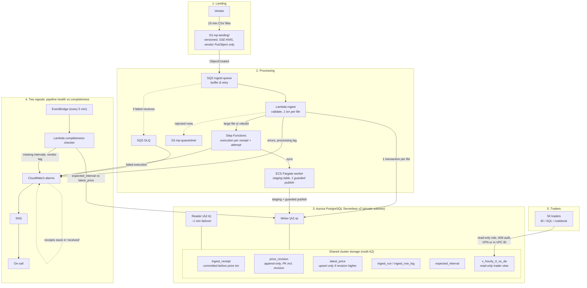

# Market Pulse on AWS: design brief

## Summary

Files are small (a few thousand rows) and arrive every 15 minutes, so the design is **event-driven and serverless**. An S3 event goes to SQS, and a Lambda function validates each file and publishes it to **Aurora PostgreSQL Serverless v2** in **one transaction per file**. Traders query a read-only hourly view. A scheduled checker reports missing prices separately from pipeline health. The prototype's model carries over (revision history, latest prices, row-level ingest log). The validation code is reused, and the SQL is translated from SQLite to PostgreSQL.

## Diagram

```
 Vendor ──every 15 min──► S3 mp-landing/ (versioned, SSE-KMS; vendor role: PutObject only)
                              │ ObjectCreated
                              ▼
                             SQS ingest-queue ──(3 failed receives)──► DLQ ──► alarm
                              │
                              ▼
                 Lambda ingest (prototype validation, 1 DB transaction per file)
        rejected rows ◄───────┤──(file > size threshold, or rebuild)──► Step Functions ─► Fargate task
        S3 mp-quarantine/     │                                         (staging table, 1 guarded publish)
                              ▼
                 Aurora PostgreSQL Serverless v2: writer AZ-a + reader AZ-b, private subnets
                   ├─ ingest_receipt     per-file status, committed before the price txn
                   ├─ price_revision     append-only, PK (market, hub, interval_start, revision)
                   ├─ latest_price       upserted in the same txn, only if revision is higher
                   ├─ ingest_run / ingest_row_log / expected_interval
                   └─ v_hourly_rt_vs_da  read-only trader view
                              ▲                               ▲
   EventBridge (every 5 min)  │                               │ read-only role, IAM auth,
   Lambda completeness-check ─┘                               │ via corporate VPN / in-VPC BI
      └─► CloudWatch alarms ─► SNS ─► on-call            Traders (BI tool / SQL / notebook)
```

The same design as a rendered diagram (Mermaid source in the Appendix):


## Services and data layout

- **S3 landing** is the immutable raw layer and the source for any rebuild. Lineage is `key + version + sha256 + row`, as in the prototype.
- **SQS + DLQ** handles retries for duplicate S3 events and failed Lambda runs, and isolates poison files. Normal files need no orchestrator; Step Functions is used only for the rare large-file and rebuild path (see Appendix).
- **Lambda `ingest`** parses, validates, upserts and logs one file. At 2–3k rows a file this should take seconds (estimate; confirm with a load test).
- **Aurora PostgreSQL** gives transactions and `ON CONFLICT`, which together make publishing atomic and idempotent.
- **`completeness-checker`** compares `expected_interval` with `latest_price` every 5 minutes. This is the "run succeeded ≠ report complete" signal.
- **Layout.** `price_revision`, `latest_price` and `expected_interval` are partitioned monthly by interval, and dropping partitions older than 24 months enforces retention (about 175M logical prices over two years, tens of GB; one Postgres instance is enough). `latest_price` is upserted with `ON CONFLICT … WHERE excluded.source_revision > latest_price.source_revision`, so an older or replayed revision never wins. An index on `(hub_id, market, interval_start_utc)` serves the "one hub, 1–7 days" query.
- **Retention:** audit tables and quarantine keep 90 days; raw S3 moves to Glacier IR after 30 days and expires after 2 years, including noncurrent versions and delete markers.

## Well-Architected pillars

| Pillar | Concrete decision | Trade-off / trigger to revisit |
| --- | --- | --- |
| **Operational excellence** | Two separate signals. **Pipeline health:** Lambda errors, DLQ depth, queue age, receipts stuck in `received`, `processing_lag = committed_at − landed_at`. **Completeness:** missing RT intervals and DA hours per hub, `vendor_lag = now − last landed file`. No file landed: **provider late**. Landed but not committed: **pipeline late**. Committed but intervals missing: check the row log for **rejections** (give the vendor the reason) versus rows **never sent**. Runbooks cover resend, DLQ redrive and notifying the desk. | Paging per missing interval across 2,000 hubs is noise, so alarms use an age threshold (e.g. RT missing 30 min after interval end) and aggregates. Per-hub detail is a query. |
| **Security** | **Vendor** can only `PutObject` to `landing/`. **Ingest** Lambda reads landing and writes to the DB as an IAM-auth user. **Traders** get `SELECT` on report views only, mapped from SSO groups. IAM auth handles identity only; the network path is the corporate VPN or an in-VPC BI tool. KMS at rest, TLS, Block Public Access, private subnets, VPC endpoints, CloudTrail on landing. Future vendor credentials go in Secrets Manager with rotation. | Prices are sensitive but not PII, so no Macie or column encryption. Revisit if licensed data needs per-trader entitlements (row-level security). |
| **Reliability** | Primary key `(key, revision)` makes duplicate delivery a no-op. The `latest_price` guard blocks rollback by an older revision. One transaction per file, so a correction is never partly visible. PITR of 14+ days, and raw S3 can rebuild everything. A **reader in a second AZ** keeps failover to about a minute. AWS says a lone writer can take up to about 10 minutes to recover, which would break the 5-minute target. | The reader roughly doubles minimum DB compute. Drop it only if the desk accepts staleness during AZ failures. It does not cover a regional outage; add cross-region only if the desk needs regional DR. |
| **Performance efficiency** | A narrow index range scan per hub and window should return well within 10 seconds (confirm with a representative load test). Per-file Lambda handles 240k rows a day without Spark. | If cross-hub scans over two years become common, export to Parquet/Iceberg for Athena and keep Aurora for operational reads. |
| **Cost optimization** | Cost is driven by Aurora ACU-hours and storage. Lambda, SQS and S3 are negligible at 96 files a day. Low minimum ACU, VPC endpoints instead of NAT, 30-day log retention. **Avoid** Redshift, EMR/Glue, Kinesis and MWAA. | If the always-on minimum dominates, compare with a small reserved RDS PostgreSQL instance. |
| **Sustainability** | Compute runs only when a file lands. Recompute touches only changed keys. Raw data is tiered, and expired data is actually deleted. | Aurora is always on. Iceberg/Athena is fully on-demand but adds compaction and slower queries. |

## Failure and recovery example

**Scenario:** a partial 14-day correction file (about 30k rows) lands, and the Lambda hits its hard timeout halfway through publishing.

1. **Nothing is half-published.** The file is one `BEGIN … COMMIT`; when the function is killed its connection drops and Postgres rolls back. Traders keep seeing the previous consistent revisions.
2. **The failure stays visible.** Before parsing, the Lambda commits an `ingest_receipt` (`status='received'`) in its own transaction; the price transaction sets it to `committed`. A receipt still `received` after N minutes raises an alarm, even though a hard timeout skips error handlers.
3. **Retry is safe.** The SQS visibility timeout is at least six times the Lambda timeout, so a running file is not picked up twice. If the commit succeeded but the SQS delete failed, the redelivered file comes back as all `duplicate`.
4. **Escalation.** After 3 failed receives the message goes to the DLQ and on-call is paged. On-call raises the timeout or memory, or routes the file to the large-file path (Appendix), then redrives. Meanwhile the checker shows those hubs as "complete, previous revision".

## Alternative rejected: S3 + Iceberg + Athena

It is serverless, cheap, and has built-in time travel. But 96 small commits a day need compaction and snapshot expiry, and correction storms cause MERGE conflicts. Athena's seconds of latency also use most of the 10-second budget, while "highest revision wins, atomically per file" is one transaction in Postgres. **Revisit** at multi-TB history, heavy cross-hub analytics, or a need for as-of queries; a nightly Iceberg export would come first. Kinesis (input is already 15-minute files) and Spark (tiny volume, slow start-up) were also rejected.

## Deferred, with risk and trigger

- **As-of queries.** History keeps every revision with `ingested_at`. Add the query when compliance or P&L explain needs it.
- **Same revision, different value.** Rejected and alarmed, never overwritten. If the vendor reuses revisions, agree a policy with them.
- **Corrections older than 14 days.** Accepted with a warning metric, because downstream periods may be closed.
- **Multi-region DR.** Not justified for a desk tool. Raw S3 cross-region replication would come first.

## Appendix: Recovery & Bulk Operations

Supporting detail for the brief above: the large-file path, rebuilding after a bug, and table sizing.

**Large files.** A full 14-day correction is far bigger than the scenario above: 2,000 hubs × 96 RT intervals × 14 days = 2,688,000 rows, or 3,360,000 with DA (2,000 × 24 × 14 = 672,000 more). That does not fit the per-file Lambda path. Before parsing, the ingest Lambda checks the S3 object size. Files above a threshold (starting at about 100k rows / 10 MB, about 40 normal files; set it from a load test so a file finishes well within the Lambda timeout) go to the staged path; smaller files take the normal path. Large files are never split into separately committed chunks, because that would bring back partial publication.

- **Worker.** The Lambda never does the long work. It checks the object size, calls `StartExecution` and returns in under a second, so the 15-minute Lambda limit and the SQS visibility timeout never come into play. Step Functions runs an ECS Fargate task (same validation code in a container image, no time limit). The task streams the file in chunks into a staging table keyed by receipt; staging commits are invisible to traders.
- **Why Step Functions, not a direct `RunTask`.** `RunTask` returns as soon as the container starts, so after the Lambda exits nothing would notice a crash 40 minutes in. The `.sync` integration waits for the task to finish, retries with backoff, marks the receipt `committed` or `failed`, alerts on-call through SNS, and keeps an execution history for on-call. Each execution is named `${receipt_id}_attempt_${n}`, with `n` read from the receipt row, so a redelivered SQS message for the same attempt gets the existing execution back instead of starting a second copy. If that execution has already closed, `StartExecution` returns `ExecutionAlreadyExists`; the Lambda treats this as already handled and deletes the message, because the receipt and execution history own the outcome (a failed run has already alerted on-call). The execution input is only `{bucket, key, version_id, receipt_id}`, with no timestamps, so a redelivery during a run matches it exactly. Step Functions will not start a new execution under the name of one that already closed (names are reserved for 90 days), so a failed run is retried with `RedriveExecution`, which resumes the same execution from the failed step (allowed up to 14 days after it fails). Only a deliberate fresh run, for example after a code fix or past the redrive window, increments `n`. A Distributed Map of Lambda chunks would also work, but one streaming process is simpler and ~3.4M rows does not need parallelism.
- **Publish.** One set-based transaction moves staging into live: `INSERT … ON CONFLICT (market, hub, interval) DO UPDATE … WHERE excluded.source_revision > latest_price.source_revision`, plus the history rows. For ~3.4M rows this takes on the order of a minute, not milliseconds. That is acceptable because MVCC keeps readers on the previous consistent revisions until commit, and the transaction runs with a `statement_timeout` so a stuck publish fails cleanly and retries.
- **No lost corrections.** The publish is revision-guarded, so it can only replace a price with a *higher* revision. A normal file that commits a newer correction while the large file is staging still wins after the publish. Normal ingest takes a shared Postgres advisory lock (`pg_advisory_xact_lock_shared`) for its transaction, and the bulk publish takes the same lock exclusively. Small files wait seconds rather than interleaving with the bulk publish. The exclusive lock covers only the publish transaction; parsing and staging happen before it. `lock_timeout` and `statement_timeout` cap it at about 2 minutes, so a small file queued behind it still meets the 5-minute target. Rebuild step 2 holds the lock a little longer, but only to replay the catch-up files, normally a handful of small ones.

**Bug-corrupted data** is rebuilt with the same worker, but a pure "highest revision wins" upsert cannot fix a wrong value stored under a correct revision. So the rebuild works in three steps:

1. Record a cutoff (the latest committed `ingest_receipt` time). Replay the raw S3 files up to that time into staging, in landing order, with the fixed code.
2. Take the exclusive lock, which pauses normal ingest for the window. Replay into staging any files committed after the cutoff (a catch-up pass, normally a handful of files).
3. Replace the window from staging in one transaction, then release the lock. Normal files that queued during the swap are applied afterwards by the usual revision rule.

Because staging includes every file up to the moment of the swap, a correction that arrives during a long rebuild is never overwritten by an older snapshot. Live rows are never deleted ahead of the rebuild.

**Table sizing.** `latest_price` holds about 175M rows at the 24-month limit (one per key; revisions do not add rows). `expected_interval` is about the same size; the checker only reads the last 14 days, but keeping two years lets completeness be checked for any period still held. Raw S3 lifecycle rules must expire **noncurrent versions** and clean up delete markers; on a versioned bucket, expiring only current objects keeps every byte.

**Diagram source.** Mermaid source for `aws_architecture.png`:


